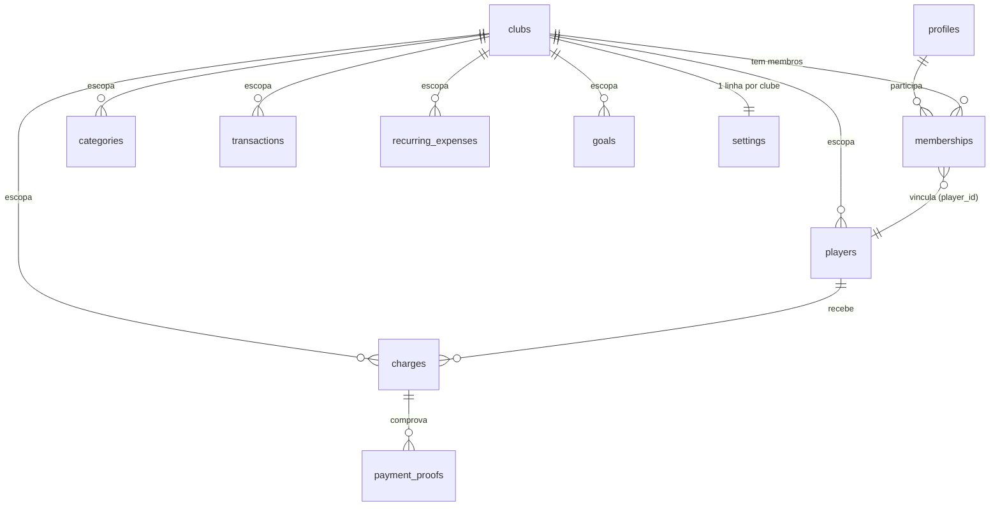
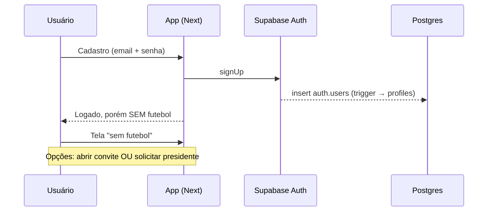
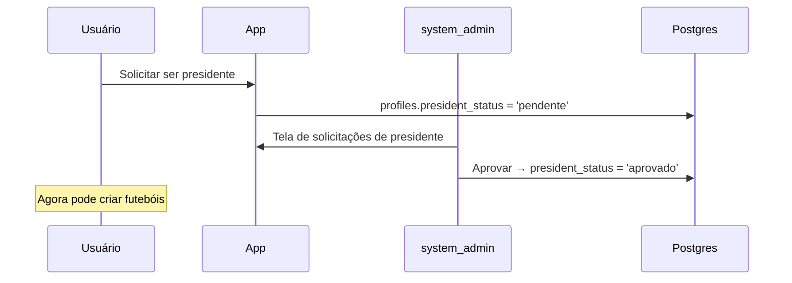
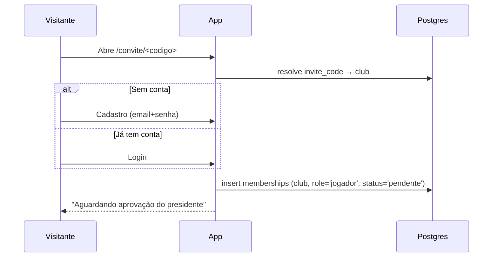

# Design — FutCaixa

## Visão geral

O FutCaixa é uma **plataforma multi-tenant** para gestão financeira de futebóis recreativos. Cada "futebol" (clube) é um **tenant** isolado: tem seus próprios jogadores, lançamentos, cobranças, despesas recorrentes, metas, categorias, configurações, auditoria, comprovantes e views agregadas. Uma mesma pessoa pode participar de **vários futebóis**, com um papel diferente em cada um.

Tecnicamente é um app Next.js (App Router) com backend no Supabase (Postgres + Auth + Storage), hospedado na Vercel. A autorização é garantida no banco via RLS — agora com dupla dimensão: **por tenant (`club_id`) E por papel do usuário naquele tenant**. A interface é uma camada de conveniência; a fonte da verdade de segurança está no Postgres. Os dashboards leem de views agregadas (sempre escopadas ao futebol ativo), nunca de linhas individuais de outros jogadores. O sorteio de times continua rodando inteiramente no cliente e permanece público.

A autenticação é **e-mail + senha com cadastro aberto** (magic link foi removido). Qualquer pessoa pode criar conta, mas **uma conta recém-criada não tem acesso a nenhum futebol**: o usuário parte de um estado "sem futebol" e só ganha acesso ao (a) abrir um link de convite de um clube (entra como membro `pendente`) ou (b) solicitar e ser aprovado como presidente e então criar o próprio futebol.

### Três níveis de papel

- **system_admin** — nível de plataforma. É um flag booleano (`is_system_admin`) em `profiles`, definido via SQL/seed (não é self-service). Aprova solicitações de presidência, enxerga e administra todos os clubes, e **ignora o escopo por tenant** (bypass de `club_id`) para administração da plataforma.
- **presidente** — administrador de um clube (o antigo papel "admin", agora escopado por futebol). Depois de aprovado como presidente, pode **criar um ou mais futebóis**, administrar cada um (dashboard, lançamentos, cobranças, configurações, categorias, jogadores), convidar jogadores, aprovar membros e promover membros a tesoureiro/presidente dentro daquele clube.
- **tesoureiro** e **jogador** — como hoje, mas escopados por futebol.

O papel **não é mais global em `profiles`**; ele vive em uma linha de `memberships` por par (usuário, clube).

### Princípios de design

- **Multi-tenant por padrão:** cada futebol é um tenant isolado; o isolamento é imposto no banco, não só na UI.
- **Segurança no servidor:** toda regra de acesso é expressa em políticas RLS, agora filtrando por `club_id` **e** pelo papel do usuário no clube.
- **Papel é por clube:** a mesma pessoa pode ser presidente de um futebol, jogador de outro e tesoureiro de um terceiro.
- **Transparência sem vazamento:** jogadores veem agregados e o próprio extrato do seu clube, nunca o detalhe financeiro de terceiros nem dados de outros clubes.
- **Dinheiro é inteiro:** valores sempre em centavos (`integer`), formatados só na borda de apresentação.
- **Nada se apaga:** soft delete + `audit_log` (escopado por clube) para rastreabilidade.
- **Pagamento plugável:** interface `PaymentProvider` isola a implementação Pix estático atual de um futuro PSP; a configuração Pix vem das **configurações do clube**.
- **Mobile-first + PWA:** layout pensado para o celular, instalável, com **navegação lateral (sidebar)** e troca de futebol.

---

## Arquitetura

```
┌─────────────────────────────────────────────────────────┐
│                      Cliente (PWA)                        │
│  Next.js App Router · React · Tailwind · shadcn/ui        │
│  Sidebar lateral (club switcher · usuário · logout)       │
│  Recharts (dashboards) · Sorteio 100% client-side         │
│  Service Worker + manifest                                │
└───────────────┬───────────────────────┬──────────────────┘
                │                        │
     Server Components /          Supabase JS client
     Server Actions / Route       (sessão do usuário)
     Handlers (Next na Vercel)             │
     escopo = futebol ativo                │
                │                           │
                ▼                           ▼
┌─────────────────────────────────────────────────────────┐
│                        Supabase                           │
│  Auth (email+senha, signup aberto) · Postgres (RLS)       │
│  RLS por TENANT (club_id) + por PAPEL (memberships)       │
│  Storage privado · Views agregadas (por club_id)          │
│  Funções RPC · Triggers de auditoria                      │
└───────────────┬───────────────────────────────────────────┘
                │
                ▼
     Cron (Vercel Cron → Route Handler protegido)
     ITERA POR CLUBE: mensalidades e despesas recorrentes
```

### Modelo multi-tenant (resumo)

- Nova entidade de topo **`clubs`** (o "futebol"). A coluna de exibição em pt-BR é "futebol".
- Quase toda tabela de domínio ganha `club_id uuid references clubs(id)`.
- **`memberships`** liga `profiles` ↔ `clubs` com papel e status. O papel do usuário em um clube vem daí.
- **`settings` deixa de ser singleton** (`id=1`) e passa a ser **uma linha por clube** (`club_id` único).
- **Categorias são semeadas por clube** na criação do clube (o seed de categorias de sistema saiu de uma migração global e virou lógica de criação de clube).
- Views agregadas (`v_monthly_summary`, etc.) passam a **agregar/filtrar por `club_id`**; os loaders de dashboard escopam ao **futebol ativo**.

### Conceito de "futebol ativo"

A aplicação precisa saber de qual clube mostrar os dados. A seleção acontece na borda da aplicação, mas **a RLS continua sendo a fronteira real** — a UI não consegue burlar o isolamento mesmo que envie um `club_id` indevido.

- O `club_id` ativo é determinado por **segmento de rota** (ex.: rotas sob `(app)/[clubId]/...`) e/ou por um **cookie/param de clube selecionado**.
- Toda query/mutation server-side injeta o `club_id` ativo e confia na RLS para rejeitar acessos a clubes onde o usuário não tem membership `ativo`.
- Se o usuário tenta operar em um clube ao qual não pertence, a RLS retorna conjunto vazio / nega a escrita, independentemente do que a UI "selecionou".

### Camadas no Next.js

- **Server Components** para telas que leem dados sensíveis (lançamentos, cobranças, inadimplentes), com o cliente Supabase na sessão do usuário — a RLS filtra por clube e papel.
- **Server Actions / Route Handlers** para mutações (criar lançamento, aprovar pagamento, criar clube, aprovar membro, aprovar presidente) e para endpoints de cron.
- **Client Components** para interações ricas: formulários, gráficos (Recharts), sorteio, fluxo de Pix (QR Code) e a **sidebar** (club switcher, logout).
- **Middleware** para proteger rotas por sessão, redirecionar não autenticados (exceto `/sorteio` e `/convite/<codigo>`) e levar o usuário "sem futebol" para a tela de onboarding.

### Organização de pastas (proposta)

```
src/
  app/
    (public)/
      sorteio/                   # aba pública
      convite/[codigo]/          # link de convite fixo do clube (público)
    (auth)/
      login/
      cadastro/                  # signup aberto (email+senha)
    (onboarding)/
      sem-futebol/               # estado inicial: solicitar presidente / abrir convite
      solicitar-presidente/
    (admin)/                     # área do system_admin (bypass de tenant)
      clubes/
      solicitacoes-presidente/
    (app)/[clubId]/              # tudo abaixo é escopado ao futebol ativo
      dashboard/
      jogadores/
      lancamentos/
      cobrancas/
      inadimplentes/
      meu-extrato/
      membros/                   # aprovar/promover membros (presidente)
      configuracoes/
    api/
      cron/gerar-mensalidades/route.ts   # itera por clube
      cron/gerar-recorrentes/route.ts    # itera por clube
  components/ui/                 # shadcn/ui
  components/layout/
    Sidebar.tsx                  # navegação lateral + club switcher + logout
  components/charts/             # wrappers Recharts
  lib/
    supabase/{server,client}.ts
    auth/
      membership.ts              # resolve papel do usuário no clube ativo
    money.ts                     # centavos ↔ BRL
    date.ts                      # America/Sao_Paulo
    payments/
      PaymentProvider.ts
      StaticPixProvider.ts
      pix/brcode.ts
      pix/crc16.ts
    clubs/
      createClub.ts              # cria club + settings + categorias semeadas
      invite.ts                  # resolve invite_code → membership pendente
    sorteio/draft.ts
    validation/
  types/
supabase/
  migrations/
  seed.sql                       # cria clube de exemplo + presidente + membros + dados por clube
```

---

## Stack e decisões

| Área | Escolha | Justificativa |
|---|---|---|
| Framework | Next.js App Router + TS | SSR/Server Actions, deploy natural na Vercel |
| Backend | Supabase (Postgres, Auth, Storage) | RLS nativo, Auth email+senha, Storage com URLs assinadas |
| Auth | E-mail + senha, **signup aberto** | Cadastro livre; acesso a clube só por convite ou aprovação de presidente |
| Multi-tenancy | `club_id` + `memberships` + RLS | Isolamento imposto no banco; papel por clube |
| UI | Tailwind + shadcn/ui | Mobile-first, componentes acessíveis, sidebar lateral |
| Gráficos | Recharts | Simples e suficiente para os dashboards |
| Validação | Zod | Schemas compartilhados entre form e server |
| Migrations | Supabase CLI | SQL versionado no repositório |
| PWA | manifest + service worker | Instalável, testado em iOS/Android |

---

## Modelo de dados

Todas as tabelas têm `id uuid default gen_random_uuid()`, `created_at timestamptz default now()` e, quando aplicável, `updated_at`. Valores monetários são `integer` em **centavos**. Soft delete via `deleted_at timestamptz null`.

**Regra multi-tenant:** toda tabela de domínio carrega `club_id uuid not null references clubs(id)`. As exceções são `profiles` (nível de usuário/plataforma), `clubs` (a própria raiz do tenant) e `memberships` (a ponte usuário↔clube, que referencia `club_id` como chave estrangeira mas não como coluna de escopo redundante).

### clubs (futebol / tenant) — NOVA

A entidade de topo. Cada linha é um "futebol".

| coluna | tipo | notas |
|---|---|---|
| id | uuid PK | |
| name | text | nome do futebol |
| slug | text null | identificador amigável opcional para rota |
| invite_code | text unique | token estável e **não expira**; usado no link `/convite/<codigo>` |
| created_by | uuid → profiles.id | presidente que criou o clube |
| logo_path | text null | |
| deleted_at | timestamptz null | |

### profiles — EVOLUÍDA

Espelha `auth.users`. Deixa de guardar o papel de domínio (que migrou para `memberships`). Passa a guardar o nível de plataforma e o status de solicitação de presidência.

| coluna | tipo | notas |
|---|---|---|
| id | uuid (PK, = auth.users.id) | |
| full_name | text | |
| is_system_admin | boolean | default false; definido via SQL/seed, nunca self-service |
| president_status | text | `none` \| `pendente` \| `aprovado` (default `none`) |
| ~~role~~ | — | **REMOVIDA** — papel agora é por clube em `memberships` |
| ~~player_id~~ | — | **REMOVIDA** — o vínculo com jogador agora é por clube em `memberships.player_id` |

Criada automaticamente por **trigger** no signup (`on auth.users insert`), já que o cadastro é aberto.

> Alternativa de modelagem para a solicitação de presidência: em vez (ou além) da coluna `president_status`, uma tabela `president_requests (id, user_id, status, requested_at, reviewed_by, reviewed_at, note)`. A coluna cobre o caso simples (um estado por usuário); a tabela dá histórico/auditoria das solicitações. **Decisão encodada:** usar `president_status` em `profiles` como fonte de verdade do estado atual, e manter a opção da tabela `president_requests` como registro de histórico se o requisito pedir trilha de aprovações. (Ver questões em aberto.)

### memberships (vínculo usuário↔clube) — NOVA

Fonte de verdade do papel de uma pessoa em um clube.

| coluna | tipo | notas |
|---|---|---|
| id | uuid PK | |
| user_id | uuid → profiles.id | |
| club_id | uuid → clubs.id | |
| role | text | `presidente` \| `tesoureiro` \| `jogador` |
| status | text | `pendente` \| `ativo` \| `recusado` |
| player_id | uuid null → players.id | preenchido quando o membro é vinculado a um jogador do clube |
| created_at | timestamptz | |
| updated_at | timestamptz | |

Unicidade: **`unique (user_id, club_id)`** — uma pessoa tem no máximo um papel por clube. O papel do usuário no clube ativo é lido daqui (nunca de `profiles`).

### players — EVOLUÍDA

Ganha `club_id`. O vínculo com login sai de `profiles.player_id` e passa a `memberships.player_id`.

| coluna | tipo | notas |
|---|---|---|
| id | uuid PK | |
| club_id | uuid → clubs.id | **NOVA** |
| name | text | |
| nickname | text null | |
| email | text null | único por clube quando presente |
| phone | text null | |
| type | text | `mensalista` \| `avulso` \| `convidado` |
| status | text | `ativo` \| `inativo` |
| skill_level | smallint | 1..3 |
| is_exempt | boolean | default false |
| exempt_reason | text null | obrigatório se is_exempt |
| custom_monthly_cents | integer null | sobrescreve padrão do clube |
| custom_drop_in_cents | integer null | avulso personalizado |
| deleted_at | timestamptz null | |

### categories — EVOLUÍDA

Ganha `club_id`. **São semeadas por clube** na criação do clube (não mais por migração global).

| coluna | tipo | notas |
|---|---|---|
| id | uuid PK | |
| club_id | uuid → clubs.id | **NOVA** |
| kind | text | `receita` \| `despesa` |
| name | text | editável |
| sort_order | integer | ordem de exibição; reordenável |
| is_active | boolean | default true |
| is_system | boolean | categorias semeadas na criação do clube; renomeáveis/desativáveis, não excluíveis se já usadas |

### transactions (lançamentos) — EVOLUÍDA

Ganha `club_id`.

| coluna | tipo | notas |
|---|---|---|
| id | uuid PK | |
| club_id | uuid → clubs.id | **NOVA** |
| kind | text | `receita` \| `despesa` |
| amount_cents | integer | > 0 (CHECK) |
| occurred_on | date | |
| category_id | uuid → categories.id | mesma `club_id` |
| description | text | |
| player_id | uuid null → players.id | opcional, mesmo clube |
| charge_id | uuid null → charges.id | preenchido quando origem é cobrança paga |
| proof_path | text null | Storage privado |
| recurring_id | uuid null → recurring_expenses.id | origem recorrente |
| created_by | uuid → profiles.id | |
| deleted_at | timestamptz null | soft delete |

### recurring_expenses — EVOLUÍDA

Ganha `club_id`.

| coluna | tipo | notas |
|---|---|---|
| id | uuid PK | |
| club_id | uuid → clubs.id | **NOVA** |
| amount_cents | integer | > 0 |
| category_id | uuid → categories.id | |
| description | text | |
| day_of_month | smallint | 1..28 |
| is_active | boolean | default true |
| last_generated_period | text null | `YYYY-MM` (idempotência) |

### charges (cobranças) — EVOLUÍDA

Ganha `club_id`.

| coluna | tipo | notas |
|---|---|---|
| id | uuid PK | |
| club_id | uuid → clubs.id | **NOVA** |
| player_id | uuid → players.id | mesmo clube |
| amount_cents | integer | > 0 |
| description | text | |
| kind | text | `mensalidade` \| `avulso` \| `multa` \| `vaquinha` |
| period | text null | `YYYY-MM` para mensalidades |
| due_date | date | |
| status | text | `pendente` \| `em_analise` \| `paga` \| `cancelada` |
| paid_at | timestamptz null | |
| txid | text | único; usado no Pix |
| deleted_at | timestamptz null | |

Unicidade: `(club_id, player_id, period)` para `kind = 'mensalidade'` (índice único parcial por clube).
"Atrasada" NÃO é coluna: `due_date < today AND status = 'pendente'`, calculado em views/queries escopadas ao clube.

### payment_proofs — EVOLUÍDA

Ganha `club_id`.

| coluna | tipo | notas |
|---|---|---|
| id | uuid PK | |
| club_id | uuid → clubs.id | **NOVA** |
| charge_id | uuid → charges.id | |
| file_path | text | bucket privado |
| uploaded_by | uuid → profiles.id | |
| status | text | `em_analise` \| `aprovado` \| `rejeitado` |
| reviewed_by | uuid null → profiles.id | |
| review_note | text null | motivo de rejeição |

### goals (metas/vaquinhas) — EVOLUÍDA

Ganha `club_id`.

| coluna | tipo | notas |
|---|---|---|
| id | uuid PK | |
| club_id | uuid → clubs.id | **NOVA** |
| title | text | |
| target_cents | integer | meta |
| current_cents | integer | acumulado |
| is_active | boolean | |

### settings — EVOLUÍDA (uma linha por clube)

Deixa de ser singleton (`id=1`). Passa a ser **uma linha por clube**.

| coluna | tipo | notas |
|---|---|---|
| id | uuid PK | |
| club_id | uuid unique → clubs.id | **NOVA** — garante uma linha por clube |
| club_name | text | nome do futebol (espelha/complementa `clubs.name`) |
| logo_path | text null | |
| pix_key | text | |
| pix_receiver_name | text | |
| pix_city | text | |
| default_monthly_cents | integer | |
| default_drop_in_cents | integer | |
| due_day | smallint | dia de vencimento |
| generation_day | smallint | dia de geração das mensalidades |
| initial_balance_cents | integer | saldo inicial do caixa |

Uma linha de `settings` é criada junto com o clube. A **configuração Pix usada nas cobranças vem da linha do clube ativo**.

### audit_log — EVOLUÍDA

Ganha `club_id` (quando a ação tem clube associado; ações de plataforma, como aprovar presidente, podem ter `club_id` nulo).

| coluna | tipo | notas |
|---|---|---|
| id | uuid PK | |
| club_id | uuid null → clubs.id | **NOVA**; nulo para ações de plataforma |
| actor_id | uuid → profiles.id | |
| action | text | ex.: `transaction.update`, `membership.approve`, `club.create`, `president.approve` |
| entity | text | tabela afetada |
| entity_id | uuid | |
| before | jsonb null | |
| after | jsonb null | |
| created_at | timestamptz | |

Preenchido por **triggers** nas tabelas sensíveis (`transactions`, `charges`, `payment_proofs`, `settings`, `memberships`, `clubs`), capturando `before/after`, `actor_id` via `auth.uid()` e `club_id` da linha afetada.

### Diagrama de relacionamento (alto nível)



---

## Papéis e permissões

| Papel | Escopo | Como é definido | Pode |
|---|---|---|---|
| **system_admin** | Plataforma | `profiles.is_system_admin` via SQL/seed | Ver/gerenciar todos os clubes; aprovar solicitações de presidente; **bypass de tenant** |
| **presidente** | Por clube | `memberships.role='presidente'` (status `ativo`) | Criar clubes; administrar o clube (dashboard, lançamentos, cobranças, config, categorias, jogadores); convidar; aprovar membros; promover/rebaixar tesoureiro/presidente |
| **tesoureiro** | Por clube | `memberships.role='tesoureiro'` | Lançamentos e aprovação de pagamentos do clube; não gerencia membros nem config sensível |
| **jogador** | Por clube | `memberships.role='jogador'` | Dashboards agregados do clube, próprio extrato e próprias cobranças, pagar via Pix |
| **público** | — | sem login | Apenas `/sorteio` e abrir `/convite/<codigo>` |

---

## Fluxos principais

### 1. Cadastro e estado "sem futebol"



Um usuário recém-cadastrado tem `profiles` mas **nenhuma membership**. O middleware o direciona para a tela de onboarding "sem futebol".

### 2. Solicitar presidência → aprovação do system_admin



Só o **system_admin** aprova. A tela de solicitações lista usuários com `president_status='pendente'`.

### 3. Criar futebol (presidente aprovado)

```mermaid
sequenceDiagram
    participant P as Presidente (aprovado)
    participant App as App
    participant DB as Postgres

    P->>App: Criar futebol (nome, pix, valores padrão...)
    App->>DB: insert clubs (gera invite_code)
    App->>DB: insert settings (1 linha do clube)
    App->>DB: seed categorias padrão DO CLUBE
    App->>DB: insert memberships (user=P, role='presidente', status='ativo')
    App-->>P: Futebol criado; link de convite /convite/<codigo>
```

Criar o clube é uma operação atômica (Server Action/RPC) que cria `clubs` + `settings` + categorias semeadas + a membership de presidente do criador.

### 4. Convite por link fixo → membro pendente



O `invite_code` é **estável e não expira**. Abrir o link cria (ou reaproveita) uma membership `pendente` como `jogador` naquele clube.

### 5. Aprovar membro → vincula a um jogador

```mermaid
sequenceDiagram
    participant P as Presidente
    participant App as App
    participant DB as Postgres

    P->>App: Tela de membros pendentes
    P->>App: Aprovar membro (escolhe tipo: mensalista/avulso)
    App->>DB: cria OU vincula players (do clube) com o tipo escolhido
    App->>DB: memberships.player_id = player; status = 'ativo'
    App-->>P: Membro ativo; "Meu extrato"/cobranças passam a funcionar
```

Ao aprovar, o presidente escolhe o **tipo de jogador** (`mensalista`/`avulso`) e o sistema **cria automaticamente (ou vincula a um existente) uma linha `players` daquele clube**, preenchendo `memberships.player_id`. Membros `avulso` **não entram na geração de mensalidades** (receita de avulso), consistente com as regras de tipo de jogador existentes.

### 6. Promoção/rebaixamento

- Dentro de um clube, o **presidente** promove membros a `tesoureiro` ou `presidente` (e pode rebaixar), alterando `memberships.role`. Tela: `/[clubId]/membros`.
- No nível de plataforma, o **system_admin** "promove" presidentes aprovando solicitações (`president_status`). Tela: `/admin/solicitacoes-presidente`.

---

## RLS — políticas por papel E por tenant

RLS habilitado em todas as tabelas. A autorização agora é função de **(auth.uid(), club_id)** via `memberships`. Funções auxiliares:

```sql
-- é administrador da plataforma? (bypass de tenant)
create function is_system_admin() returns boolean language sql stable as $$
  select coalesce((select is_system_admin from profiles where id = auth.uid()), false)
$$;

-- papel do usuário atual NO clube informado (null se não for membro ativo)
create function club_role(p_club_id uuid) returns text language sql stable as $$
  select role from memberships
  where user_id = auth.uid()
    and club_id = p_club_id
    and status  = 'ativo'
$$;

-- é membro ativo do clube?
create function is_member_of(p_club_id uuid) returns boolean language sql stable as $$
  select is_system_admin() or club_role(p_club_id) is not null
$$;

-- jogador (players.id) que o usuário representa no clube
create function my_player_id(p_club_id uuid) returns uuid language sql stable as $$
  select player_id from memberships
  where user_id = auth.uid() and club_id = p_club_id and status = 'ativo'
$$;
```

### Padrão geral das políticas

Toda tabela de domínio segue o padrão: **o usuário só enxerga/edita linhas de clubes onde tem membership `ativo` com papel suficiente**, e o `system_admin` ignora o escopo.

```sql
-- Leitura de uma tabela escopada ao clube (ex.: players)
create policy players_select on players
for select using (
  is_system_admin() or is_member_of(club_id)
);

-- Escrita restrita a presidente/tesoureiro do MESMO clube (ex.: transactions)
create policy transactions_write on transactions
for all using (
  is_system_admin()
  or club_role(club_id) in ('presidente','tesoureiro')
) with check (
  is_system_admin()
  or club_role(club_id) in ('presidente','tesoureiro')
);
```

### Resumo das políticas (dentro de um clube; system_admin vê/gerencia tudo)

| Tabela | presidente | tesoureiro | jogador |
|---|---|---|---|
| clubs | SELECT (os seus); UPDATE (os seus) | SELECT | SELECT |
| memberships | CRUD (do clube); aprovar/promover | SELECT | SELECT a própria |
| players | CRUD | SELECT | SELECT (campos não sensíveis) |
| categories | CRUD | SELECT | SELECT |
| transactions | CRUD | CRUD | sem acesso direto (usa views) |
| recurring_expenses | CRUD | CRUD | — |
| charges | CRUD | CRUD | SELECT **apenas as próprias** (`player_id = my_player_id(club_id)`) |
| payment_proofs | CRUD/aprovar | CRUD/aprovar | INSERT/SELECT **apenas as próprias** |
| goals | CRUD | SELECT | SELECT |
| settings | CRUD | SELECT (dados Pix) | SELECT (dados Pix) |
| audit_log | SELECT | SELECT | — |
| views agregadas | SELECT | SELECT | SELECT (do clube) |

Políticas de nível de plataforma:

```sql
-- Somente system_admin lê solicitações de presidente de outros usuários;
-- um usuário vê/edita o próprio president_status.
create policy profiles_president_requests on profiles
for select using (
  id = auth.uid() or is_system_admin()
);
```

Exemplo de policy (cobranças do jogador, agora por clube):

```sql
create policy charges_player_select on charges
for select using (
  is_system_admin()
  or club_role(club_id) in ('presidente','tesoureiro')
  or player_id = my_player_id(club_id)
);
```

**Storage:** bucket `proofs` privado. O caminho do arquivo inclui o `club_id` (ex.: `proofs/<club_id>/<charge_id>/...`). Upload permitido ao dono da cobrança e a presidente/tesoureiro do **mesmo clube**; leitura só via URL assinada gerada no servidor. As policies de Storage espelham "dono ou gestor do clube".

**Observação sobre o futebol ativo:** a UI escolhe um `club_id` ativo (rota/cookie), mas a RLS é a fronteira real — mesmo que a UI envie um `club_id` arbitrário, `is_member_of`/`club_role` barram o acesso a clubes alheios. O `system_admin` é a única exceção (bypass para administração).

---

## Views agregadas (dashboards)

Os dashboards consultam somente estas views, **sempre filtrando por `club_id`** (o futebol ativo). Elas não expõem identidade financeira individual de terceiros nem dados de outros clubes.

- **v_monthly_summary** — por `club_id` e mês (`YYYY-MM`): soma de receitas, soma de despesas, resultado do mês.
- **v_category_breakdown** — por `club_id`, mês e categoria: soma de despesas.
- **v_balance_history** — por `club_id`: saldo acumulado = `settings.initial_balance_cents` do clube + soma corrida de (receitas − despesas).
- **v_delinquency_rate** — por `club_id` e mês: % de adimplência = cobranças pagas / devidas.

**Runway** derivado em query/RPC por clube: `saldo_atual / média_despesas_últimos_3_meses`, tratando divisão por zero.

As views carregam `club_id` na projeção e são `security_invoker` quando necessário, de modo que a RLS das tabelas-base (que já filtra por membership) continue valendo; os loaders de dashboard sempre passam o `club_id` ativo no `where`.

---

## Camada de pagamento (Pix)

### Interface `PaymentProvider`

```ts
interface PaymentCharge {
  amountCents: number;
  txid: string;        // único por cobrança
  description: string;
}

interface PaymentResult {
  payload: string;     // "copia e cola"
  qrcodeData: string;  // mesmo payload, para render do QR
}

interface PaymentProvider {
  createStaticCharge(charge: PaymentCharge): PaymentResult;
  // Futuro PSP: createDynamicCharge(), handleWebhook()
}
```

A implementação atual é `StaticPixProvider`, que monta o BR Code e NÃO confirma pagamento automaticamente — a confirmação é manual (comprovante → aprovação). **A chave Pix, o nome do recebedor e a cidade vêm da linha de `settings` do clube ativo**, não de uma configuração global. Um futuro `MercadoPagoProvider`/`AsaasProvider` implementaria Pix dinâmico com webhook, sem alterar as regras de cobrança (que só dependem da interface).

### BR Code / EMV (Pix estático)

O payload segue o formato TLV (`ID` + `tamanho` + `valor`) do padrão EMV do BCB. Campos principais:

- `00` Payload Format Indicator = `01`
- `26` Merchant Account Information (GUI `br.gov.bcb.pix` + chave + opcional descrição)
- `52` Merchant Category Code = `0000`
- `53` Moeda = `986` (BRL)
- `54` Valor (ex.: `25.00`)
- `58` País = `BR`
- `59` Nome do recebedor (até 25 chars)
- `60` Cidade (até 15 chars)
- `62` Additional Data (campo `05` = txid)
- `63` CRC16 (calculado por último, sobre todo o payload incluindo `6304`)

O nome e a cidade (vindos das configurações do clube) são normalizados (sem acentos, maiúsculas, truncados) para compatibilidade com bancos.

### CRC16-CCITT (polinômio 0x1021, inicial 0xFFFF)

```
Para cada byte do payload (incluindo "6304"):
  crc ^= byte << 8
  repetir 8 vezes:
    se (crc & 0x8000): crc = (crc << 1) ^ 0x1021
    senão:             crc = crc << 1
  crc &= 0xFFFF
Resultado: 4 hex maiúsculos.
```

Testes unitários cobrem: payloads de referência com CRC conhecido, valor com centavos, nome/cidade no limite de tamanho, e txid variável. **A camada de montagem do BR Code é independente de tenant** (recebe os dados do clube como entrada), então os testes não mudam.

---

## Algoritmo de sorteio (client-side)

O sorteio **permanece público e 100% no cliente, inalterado pela multi-tenancy**. Entrada: lista de `{ nome, nivel (1..3) }`, número de times `T`, cores dos times. (Quando aberto por um usuário logado, pode opcionalmente pré-carregar nomes dos jogadores do clube ativo, mas não depende disso.)

```
1. Agrupar jogadores em potes por nível (pote 1 = mais fracos ... pote 3 = mais fortes),
   para distribuir cada nível de forma equilibrada.
2. Ordenar os potes de forma a processar nível a nível (serpente/round-robin).
3. times = T listas vazias, rotuladas pelas cores na ordem informada.
4. Para cada rodada (enquanto houver jogadores):
     a. embaralhar a ORDEM dos times nesta rodada;
        - exceção: na 1ª rodada (primeiras N retiradas), garantir N cores distintas
          atribuindo um time diferente a cada uma das N primeiras retiradas.
     b. para cada time (na ordem embaralhada), retirar 1 jogador do pote corrente;
        quando um pote esvazia, passar ao próximo.
5. Sobras (total não divisível por T) acabam naturalmente em rodadas parciais:
   garantir que caiam em times diferentes (a ordem embaralhada já favorece isso).
6. Resultado: mapa cor → jogadores.
```

Propriedades testadas:
- **Distribuição de cores:** as primeiras N retiradas produzem N cores diferentes.
- **Equilíbrio de níveis:** a diferença de soma de níveis entre o time mais forte e o mais fraco é mínima (≤ nível máximo).
- **Sobras:** com `jogadores % T != 0`, os times extras recebem no máximo 1 jogador a mais e em times distintos.
- **Determinismo opcional:** aceitar uma seed para reproduzir resultados nos testes.

Estado persistido em `localStorage` (lista, níveis, times, cores, último resultado).

---

## Crons — decisão (agora por clube)

**Escolha: Vercel Cron** chamando Route Handlers protegidos (`/api/cron/gerar-mensalidades` e `/api/cron/gerar-recorrentes`).

A diferença multi-tenant: cada rotina **itera por clube**. O handler percorre todos os `clubs` ativos e, para cada um, lê a `settings` do clube (dia de geração, valores padrão, Pix) e gera cobranças/lançamentos escopados àquele `club_id`.

```
para cada club em clubs (não deletados):
  s := settings do club
  se hoje == s.generation_day:
     gerar mensalidades dos jogadores mensalista/ativo/não-isento DO club
  gerar despesas recorrentes ativas DO club cujo day_of_month == hoje
```

Justificativa (mantida):
- O deploy já é na Vercel; não exige `pg_cron` nem credenciais de serviço no banco.
- A lógica de geração fica em TypeScript, próxima das regras de negócio e dos schemas Zod.
- Idempotência por chaves no banco: índice único parcial em `charges(club_id, player_id, period)` e `recurring_expenses.last_generated_period` (por clube).

Proteção dos endpoints: header secreto (`CRON_SECRET`) validado no handler; a rota usa a service role apenas no servidor. Como a service role **bypassa RLS**, o handler deve filtrar explicitamente por `club_id` em cada iteração para não cruzar dados entre clubes.

Alternativa considerada (`pg_cron`): mantém o agendamento dentro do Postgres; fica registrada como opção caso o projeto migre de hospedagem.

---

## UI — navegação lateral (sidebar), troca de futebol e logout

A área autenticada usa uma **sidebar lateral** (menu na lateral) no lugar da navegação no topo, **mobile-first**: em telas pequenas vira um drawer colapsável (hambúrguer); em telas largas fica fixa.

Conteúdo da sidebar:
- **Club switcher (trocar de futebol):** aparece quando o usuário tem membership `ativo` em mais de um clube; troca o `club_id` ativo (muda a rota/cookie). Para quem tem um só clube, mostra o nome do clube sem seletor.
- **Links de navegação** filtrados pelo papel do usuário no clube ativo (presidente vê tudo; tesoureiro vê lançamentos/cobranças; jogador vê dashboard/meu extrato).
- **Entrada de administração da plataforma** (clubes, solicitações de presidente) visível apenas para `system_admin`.
- **Identidade:** nome do usuário e papel no clube ativo.
- **Logout:** ação visível que encerra a sessão do Supabase e redireciona para o login.

Estados de navegação especiais:
- Usuário **sem futebol:** sidebar mínima com onboarding ("solicitar presidente" / "abrir convite") e logout.
- **Presidente aprovado sem clube ainda:** CTA "Criar futebol".

---

## Formatação, i18n e dinheiro

- `lib/money.ts`: `toCents(str)`, `fromCents(n)` → `Intl.NumberFormat('pt-BR', { style:'currency', currency:'BRL' })`. Independente de tenant.
- `lib/date.ts`: `dd/mm/aaaa` e períodos sempre em `America/Sao_Paulo`.
- Toda a UI em pt-BR.

---

## PWA

- `manifest.webmanifest` com nome, ícones (maskable), `display: standalone`, cor do tema. Inalterado pela multi-tenancy.
- Service worker com cache da app shell e estratégia network-first para dados; offline mostra shell + aviso. **Cuidado:** não cachear respostas de dados de forma que possam vazar entre clubes ao trocar de futebol — o cache de dados deve ser chaveado por `club_id` ou invalidado na troca.
- Testar instalação no Safari/iOS e Chrome/Android.

---

## Tratamento de erros

- **Validação:** Zod no cliente e revalidação no servidor — nunca confiar só no front.
- **Autorização:** erros de RLS tratados como "não autorizado" com mensagem genérica. Acesso a clube alheio retorna conjunto vazio / negação, sem revelar existência de dados.
- **Futebol ativo inválido:** se o `club_id` da rota não corresponder a uma membership ativa, redirecionar para o seletor de clube (ou "sem futebol").
- **Pix:** se faltar configuração do clube (chave/recebedor/cidade), bloquear geração do QR e orientar a configurar nas Configurações do clube.
- **Crons:** logar falhas por clube; idempotência evita efeitos colaterais em reexecução; uma falha em um clube não deve abortar os demais.
- **Upload de comprovante:** validar tipo (imagem/PDF) e tamanho; falha não altera o status da cobrança.

---

## Estratégia de testes

- **Unitários (obrigatórios por escopo):**
  - CRC16 e montagem do BR Code (payloads de referência; dados do clube como entrada).
  - Algoritmo de sorteio (cores, equilíbrio, sobras, com seed).
  - Conversões de dinheiro (centavos ↔ BRL) e datas (fuso).
- **Integração:**
  - Criação de clube cria `settings` + categorias semeadas + membership de presidente.
  - Fluxo de convite → membership pendente → aprovação → vínculo com `players`.
  - Geração de mensalidades/recorrentes **por clube** (idempotência; não cruza clubes).
  - Fluxo de cobrança → aprovação → lançamento de receita, escopado ao clube.
- **Políticas RLS (dupla dimensão — crítico):**
  - Usuário de um clube **não lê** dados de outro clube (nenhuma tabela, nenhuma view).
  - Jogador não lê cobranças de terceiros nem acessa `transactions` direto.
  - `tesoureiro` não gerencia membros nem configurações; `presidente` sim, só no próprio clube.
  - `system_admin` enxerga todos os clubes (bypass) mas isso não "vaza" para os demais papéis.
- Ferramenta: Vitest para unidades; testes de RLS via cliente Supabase com usuários de papéis/clubes distintos em ambiente de teste.

---

## Migração e seed (reset de dados)

Os dados existentes serão **descartados** (reset limpo), o que simplifica a evolução multi-tenant.

- **Migrações para frente:** novas migrações adicionam `clubs`, `memberships`, `club_id` em todas as tabelas de domínio, `settings.club_id unique`, `invite_code`, `is_system_admin`/`president_status` em `profiles`, e as funções auxiliares + policies novas.
- Como o banco de dev pode ser zerado, é aceitável adicionar `club_id` como **`NOT NULL`** diretamente (sem backfill), partindo do pressuposto de reset.
- O **seed de categorias de sistema sai da migração global** e vira lógica de criação de clube (`createClub`).
- A migração que criava `settings` singleton (`id=1`) é removida/substituída pela `settings` por clube.
- **`seed.sql` reescrito** para criar: um clube de exemplo, seu presidente (membership `presidente` ativo), alguns membros (jogadores vinculados a `players`), categorias/settings por clube e ~6 meses de lançamentos — tudo escopado ao `club_id` de exemplo. Opcionalmente, um `system_admin` de exemplo (`is_system_admin=true`).

---

## Resumo das mudanças vs. design single-tenant

| Área | Antes (single-tenant) | Agora (multi-tenant) |
|---|---|---|
| Entidade de topo | — | `clubs` (futebol) |
| Papel | `profiles.role` (global) | `memberships.role` (por clube) |
| Vínculo com jogador | `profiles.player_id` | `memberships.player_id` (por clube) |
| settings | singleton `id=1` | 1 linha por clube (`club_id` unique) |
| categorias | seed global por migração | semeadas na criação do clube |
| Auth | magic link, e-mails pré-cadastrados | e-mail+senha, **signup aberto** |
| Acesso inicial | papel definido pelo admin | "sem futebol" até convite/aprovação |
| RLS | por papel | por papel **E** por `club_id` |
| Crons | uma passada | iteram **por clube** |
| Pix | config global | config da `settings` do clube |
| Navegação | nav no topo | **sidebar lateral** + club switcher + logout |
| Sorteio | público client-side | inalterado (público client-side) |
